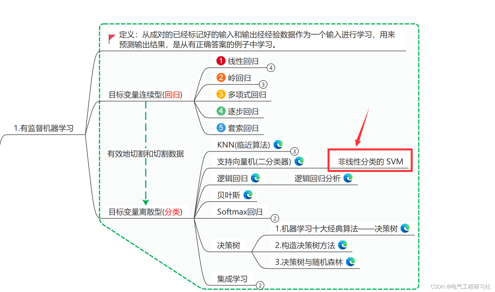
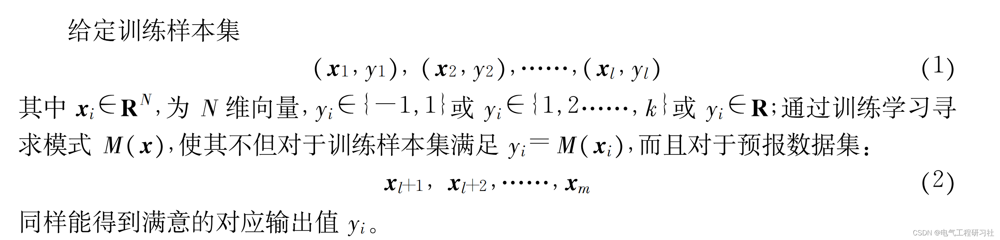
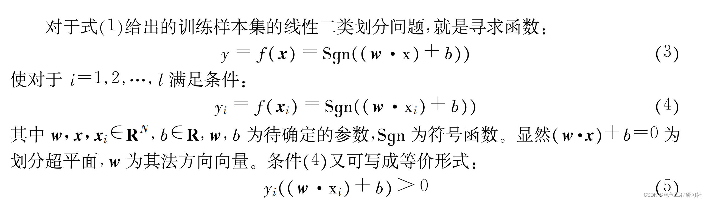
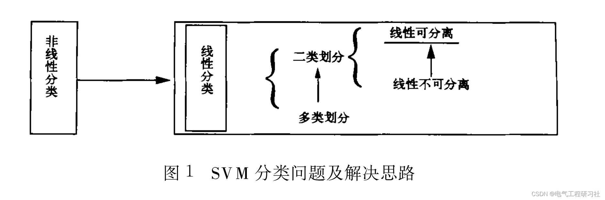
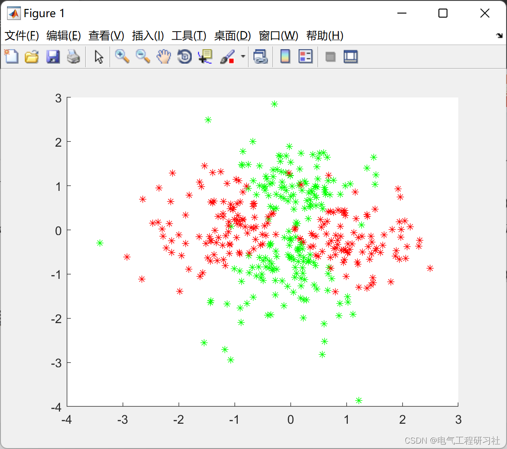
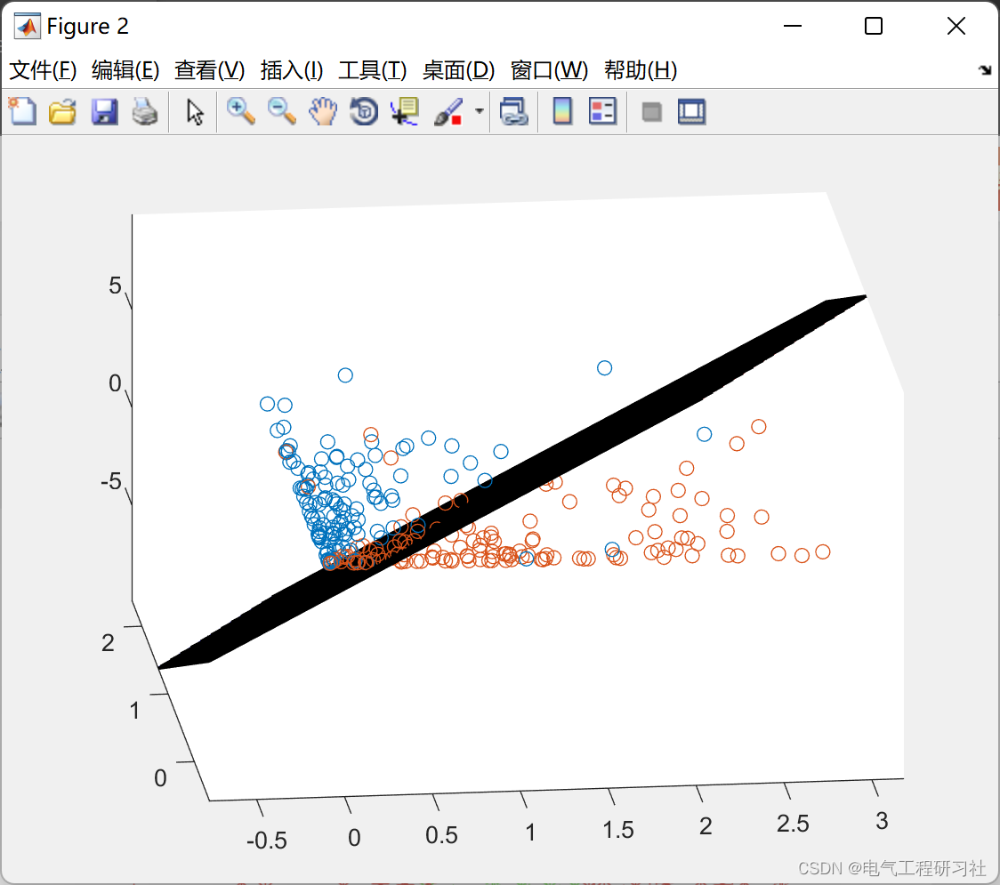
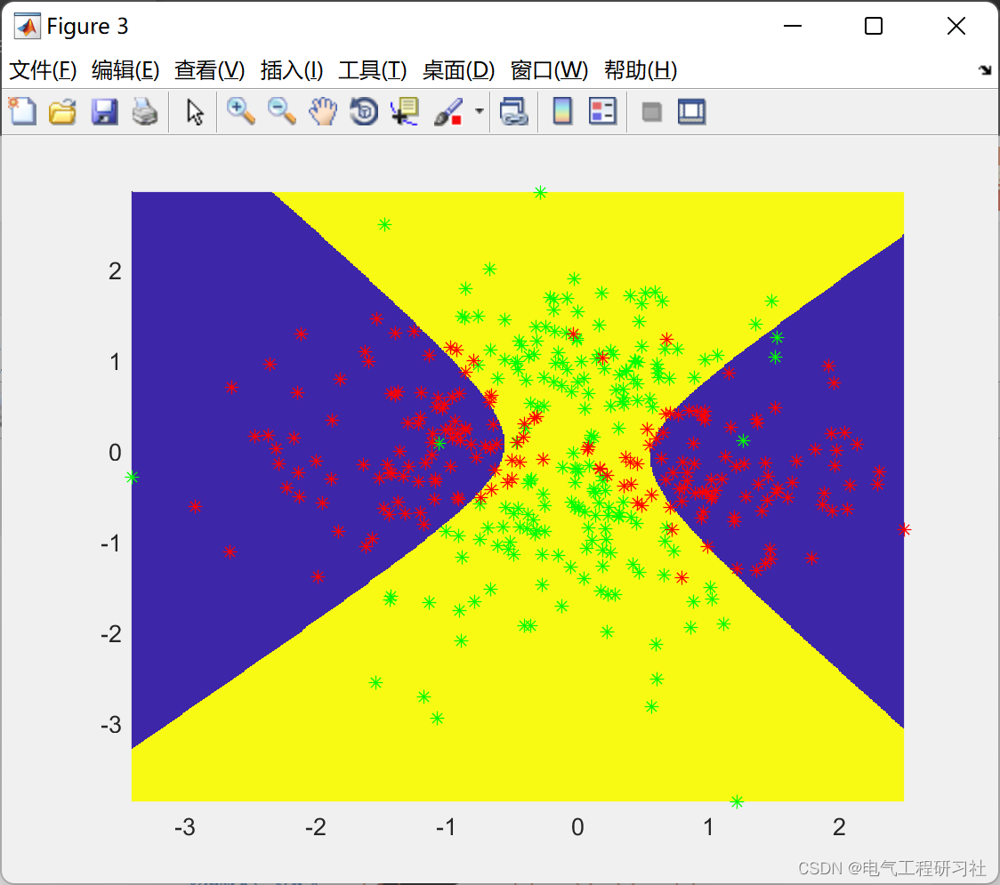

# A New Method for Handling Non-linear Classification and Regression Problems (I) ——— Support Vector Machine Method Introduction (Matlab Code Implementation)

​  
Editor
1 Overview revealing the secrets of learning through human thinking is a historic challenge. If, a few decades ago, it was only the thoughts of a few philosophers and academic pioneers, then due to the rapid development of information technology and the widespread application of computers, learning issues, especially machine learning problems, have become practical issues that must be faced by researchers and technicians.
The essence of learning is inductive reasoning, which is rarely addressed by classical logic. Three fundamental aspects of learning are pattern recognition, regression analysis, and density estimation. Scholars have achieved numerous research results through methods such as probability statistics and function approximation, especially in addressing linear problems, some of which are even perfect. However, there is a lack of satisfactory results for essentially nonlinear issues. When faced with data without a theoretical model, statistical analysis methods are the first to be adopted. However, traditional statistical methods only have theoretical guarantees when the sample size approaches infinity. In practical applications, sample sizes are usually finite, even small, making traditional statistical methods based on the law of large numbers difficult to achieve ideal results.
2. Category and regression problem formulations
3. Optimal Splitting of Linear Hyperplanes and Support Vectors
Editor
4. Running Results Edit
Editor
Editor
5. Matlab code and detailed explanation of the article. This article only showcases a portion of the code, all code and articles can be found in:
6. References [1] Chen Yongyi, Yu Xiaodong, Gao Xuehao, Feng Hanzhong. A New Method for Handling Nonlinear Classification and Regression Problems (I) - An Introduction to Support Vector Machine Methods [J]. Journal of Applied Meteorology, 2004(03):345-354.
7. Conclusion

## Images

<!-- PAYMENT_BLOCK -->

## Get this dataset

- Payment link (Stripe): [Buy now](https://buy.stripe.com/3cs8yP7sY87d0vu9AB)
- Payment QR code: 

<!-- /PAYMENT_BLOCK -->
